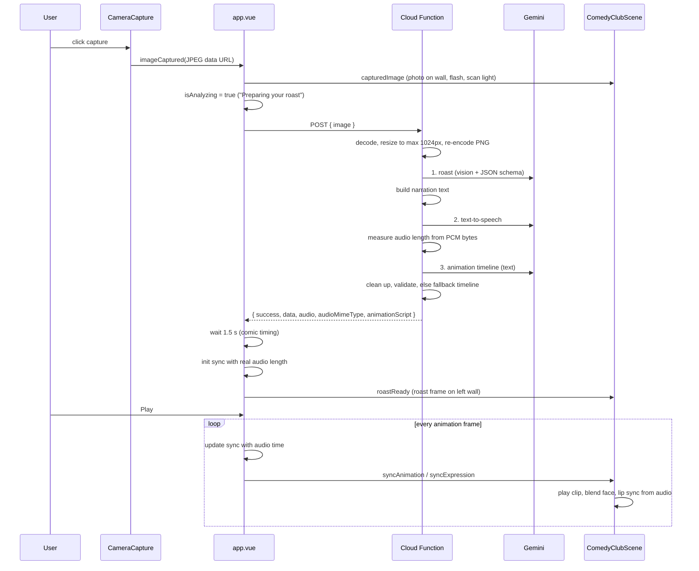

# Request lifecycle

From clicking capture to the comedian performing.

## Step details

| Step | Code | What can go wrong |
| --- | --- | --- |
| Capture | `components/CameraCapture.vue` `captureImage()` | Camera denied → `alert()`. |
| Send | `composables/useRoastApi.js` `requestRoast()` | URL unset, network error or 5xx → mock data plus a "sample roast" notice ([[Mock Mode]]). 4xx → the API's error message is shown. |
| Parse image | `functions/utils/image_utils.py` | Missing → 400. Undecodable → 400 `Invalid image data`. |
| Roast | `functions/services/roast_service.py` | Blocked or unparseable → `ValueError` → 400 with the message. |
| TTS | `functions/services/tts_service.py` | Any failure → logged, response has no `audio`. Roast still returned. |
| Animation | `functions/services/animation_service.py` | Any failure → fallback script. Never fails the request. |
| Show result | `app.vue` `fetchRoast()` → `handleRoastReceived()` | Response without `success`/`data` → error banner, camera returns. |
| Playback | `app.vue` `playAudio()` | Decode error → message under the controls. |

## Order matters
The three Gemini calls run **one after another**: TTS needs the narration from the roast, and the animation call needs the audio length from TTS. Total time is the sum of all three. See [[Cost & Limits]].

"Roast Again" runs the same flow with the existing photo (`reRoast()` → `fetchRoast()`).
