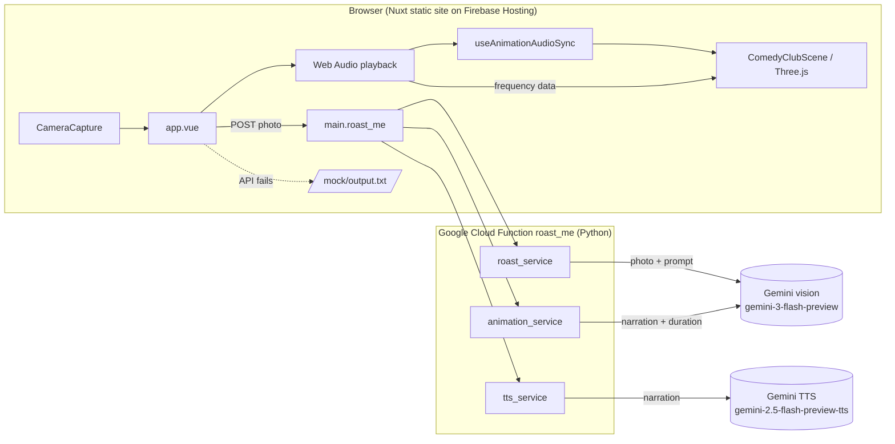

# System overview

## Pieces

| Piece | Where | Runs on | Notes |
| --- | --- | --- | --- |
| Frontend | repo root (`app.vue`, `components/`, `composables/`) | Firebase Hosting, as a static `nuxt generate` build | Nuxt 4, Vue 3, Three.js 0.182, Tailwind. No server-side rendering at runtime; everything runs in the browser. |
| Backend | `functions/` | Google Cloud Functions gen 2, Python 3.10, `us-central1` | One HTTP function, `roast_me`. No database, no storage, no auth. |
| AI | Google Gemini API via `google-genai` | Google | Three calls per roast. See [[Cost & Limits]]. |
| Character | `public/comedian.glb` | served as a static file | See [[comedian.glb]]. |

The GCP project for both hosting and the function is `fun-series-gcloud` (`.firebaserc` and the workflows).

## Key design points
- **One request does everything.** The browser sends a photo and gets back the roast text, the full audio (base64) and the animation timeline in one JSON response. Nothing streams. See [[Request Lifecycle]].
- **The backend plans the animation, the frontend performs it.** Gemini picks the animations and expressions, and the backend checks them against a set of rules (posture, walk order). The frontend only follows the timeline. See [[Animation Script Pipeline]] and [[Animation-Audio Sync]].
- **Lip sync is audio-driven, not text-driven.** Mouth movement comes from live frequency analysis of the playing audio, not from phonemes. See [[Face & Lip Sync]].
- **Graceful degradation.** No audio → roast still shows. Bad animation script → fallback script. API down → mock roast.
