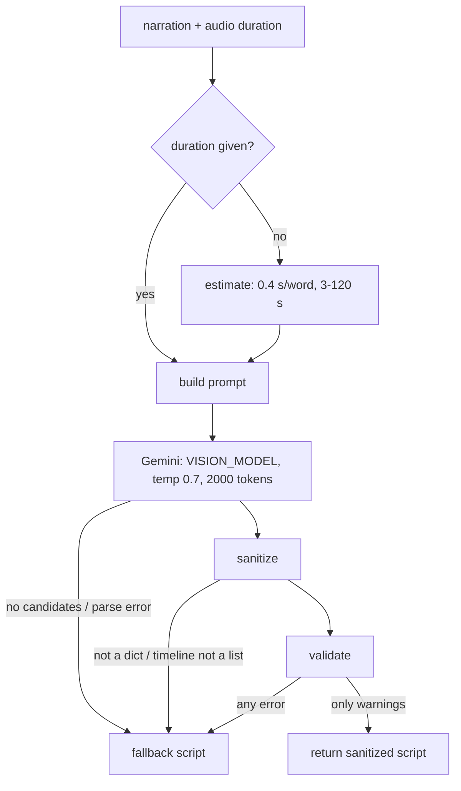

# Animation script pipeline

Turns the narration into a timeline of body animations and expressions for the character.

| File | Role |
| --- | --- |
| `functions/services/animation_service.py` | Orchestrates: prompt → Gemini → clean up → validate → fallback |
| `functions/services/animation_prompt.py` | Builds the prompt from sections |
| `functions/services/animation_constants.py` | The animation and expression catalogue, rules and limits. **The backend's source of truth.** |
| `functions/services/animation_utils.py` | JSON extraction, fallback script, name fixing, clean-up |
| `functions/services/animation_validator.py` | Rule checks, split into errors and warnings |

## Flow

Any exception anywhere also returns the fallback, so this step never fails the request.

## Duration
`main.py` passes the **measured** audio length (`tts_service.get_audio_duration`). The word-count estimate is only used when there is no audio.

## Prompt
Sections, in order: valid names only · posture rules · walk sequence rules · "no auto-transitions" (the character only plays what the timeline lists, so every walk step needs its own keyframe) · animation list with durations and use cases · expression list · constraints (duration, 3–10 keyframes, intensity 0–1) · **the full transcript**, with a note that speech is spread evenly over the duration so it can time gestures to the jokes · response JSON format · requirements checklist (with the real duration) · strategy tips · common mistakes.

Gemini's reply is parsed by taking everything from the first `{` to the last `}`, which handles markdown fences and extra text.

## Sanitize (`sanitize_animation_script`)
Runs **before** validation, so fixable mistakes are repaired instead of rejected:
- Animation names go through `fix_invalid_animation_name`: exact valid names are kept, known mistakes are mapped case-insensitively (`walkThink` → `walk-think`, `dance` → `aerobic-dance`, `sit` → `stand-to-sit`, `sit-talk` → `idle`, …), then any camelCase name is converted to kebab-case and kept if valid (`walkRelaxedStart` → `walk-relaxed-start`). Anything else becomes `idle`. Covered by `functions/tests/test_animation.py` (see [[Testing]]).
- Unknown expressions → `neutral`.
- Intensity clamped to 0–1 (non-numbers → 0.5).
- Non-dict keyframes dropped. Missing times default to 0, so validation then rejects them.

## Validate (`validate_animation_script`)
Returns `(is_valid, errors, warnings)`. Only **errors** reject the script.

| Errors (→ fallback) | Warnings (logged, script used) |
| --- | --- |
| Script not a dict, timeline missing, empty or not a list | Missing metadata, metadata duration off by > 2 s, bad metadata intensity |
| Keyframe missing `startTime`/`endTime`/`animation`/`expression`/`intensity` | Fewer than 3 or more than 10 keyframes |
| Non-numeric or negative times, `endTime <= startTime` | First keyframe starts after 0.5 s |
| Invalid animation/expression name or intensity (normally fixed by sanitize already) | Timeline ends more than 1 s before the audio |
| Sit lock: anything but `idle` after `stand-to-sit` | Keyframe ends more than 1 s after the audio |
| Walk order: loop without start, end without loop, idle straight after loop | Gap of more than 1 s between keyframes |

## Fallback script
`generate_default_animation_script(duration, transcript)`: five sections at 0–20–45–70–85–100 % of the duration:

| Section | Animation | Expression | Intensity |
| --- | --- | --- | --- |
| Opening | idle | neutral | 0.4 |
| Building | walk-think | smile | 0.6 |
| Climax | spellcast | laugh | 0.9 |
| Peak | aerobic-dance | laugh | 0.8 |
| Closing | relax | smile | 0.5 |

`metadata.fallback = true`. Check this flag in responses or logs to see how often Gemini's script is being thrown away.

## Changing the animation set
See [[Animation Catalogue]]. Names must match in three places or keyframes get ignored.
