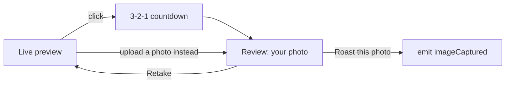

# Camera capture

`components/CameraCapture.vue`

## Flow

- **Live preview.** On mount: `getUserMedia({ video: { facingMode: 'user', width: 1280, height: 720 (ideal) }, audio: false })`. The capture button is disabled until the video has loaded (`cameraReady`).
- **Countdown.** `startCountdown()` counts `COUNTDOWN_SECONDS` (3) down once a second, then `captureFrame()` draws the frame to a hidden canvas at the video's native size → `toDataURL('image/jpeg', 0.9)` → `previewImage`.
- **Review.** The `<video>` is hidden (`v-show`, so the stream keeps running and Retake is instant) and the captured image is shown. Text says only this single photo gets roasted and the camera turns off once confirmed. **Retake** clears `previewImage`. **🔥 Roast this photo** emits `imageCaptured(dataUrl)`.
- **Upload.** A hidden `<input type="file" accept="image/*">`. `handleFileSelected` loads the file into an `Image`, scales it so the longest side is at most `MAX_UPLOAD_DIMENSION` (1280), and re-encodes it as JPEG 0.9, so uploads are sent exactly like snapshots. Files the browser can't decode (e.g. HEIC on most desktop browsers) show "Couldn't read that image. Try a JPEG or PNG."
- **No camera.** If `getUserMedia` fails, the preview is replaced by a message (blocked → how to allow it; otherwise "couldn't open a camera") and **📁 Upload a photo** becomes the main button. No `alert()`.

## Details
- The live preview is mirrored with CSS (`transform: scaleX(-1)`). The **captured image is not mirrored**: the review shows exactly what is sent.
- The component does no networking. `app.vue` sends the photo (see [[App Shell & State]]).
- The confirm click is also what lets `app.vue` unlock audio for autoplay (see [[Audio Playback]]), because it runs inside the user's click.
- The camera stream is stopped on unmount, which happens as soon as the parent has a photo (`v-if="!capturedImage"`).

Camera access needs a secure context: HTTPS, or `localhost` in development.
